<p align="center">
  
</p>

<h1 align="center">CraftyBay — E-Commerce Application</h1>

<p align="center">
  <strong>A production-grade, pixel-perfect Flutter e-commerce application built with GetX, REST API integration, and SSLCommerz payment gateway.</strong>
</p>

<p align="center">
  <a href="https://flutter.dev"></a>
  <a href="https://dart.dev"></a>
  <a href="https://pub.dev/packages/get"></a>
  <a href="https://sslcommerz.com"></a>
  <a href="https://github.com/Rohan2002-33/crafty_bay_ecommerce_app/blob/main/LICENSE"></a>
</p>

---

## 📖 Table of Contents
- [✨ Overview](#-overview)
- [📱 Master UI Overview](#-master-ui-overview)
- [📸 Screen-by-Screen Showcase](#-screen-by-screen-showcase)
- [🚀 Key Features](#-key-features)
- [🏗️ Project Architecture](#️-project-architecture)
- [🛠️ Tech Stack & Dependencies](#️-tech-stack--dependencies)
- [🏁 Getting Started](#-getting-started)
- [🧪 Testing & Verification](#-testing--verification)
- [💳 Payment Gateway & Checkout Flow](#-payment-gateway--checkout-flow)
- [🌐 REST API Integration](#-rest-api-integration)
- [👤 Author & Acknowledgements](#-author--acknowledgements)

---

## ✨ Overview

**CraftyBay** is an enterprise-grade mobile e-commerce platform developed with **Flutter** and **GetX**. Designed 100% pixel-perfect against the reference UI specification across all 13 core screens, it offers a seamless shopping journey—from discovery and cart management to profile completion and dual-mode checkout (Cash on Delivery + SSLCommerz Online Payment Gateway).

### Key Highlights
- **100% Design Accuracy:** Exact color scheme (`#07ADAE` primary brand teal), typography, custom bottom navigation bar, card elevations, and rounded layouts matching the Figma reference.
- **Robust Architecture:** Separation of concerns using Model-View-Controller with GetX dependency injection and reactive state bindings.
- **Authentic Product Catalog:** 34 curated products distributed across 8 rich categories with high-definition real images, color/size variants, reviews, and descriptions.
- **Resilient Offline & Online Sync:** Persistent local storage using `shared_preferences` that safeguards cart items and wishlists alongside remote MongoDB endpoints.
- **Fully Functional Checkout:** Live SSLCommerz payment integration in an interactive in-app WebView, plus instant Cash on Delivery order processing.

---

## 📱 Master UI Overview

The application faithfully implements all screens defined in the official specification:

<p align="center">
  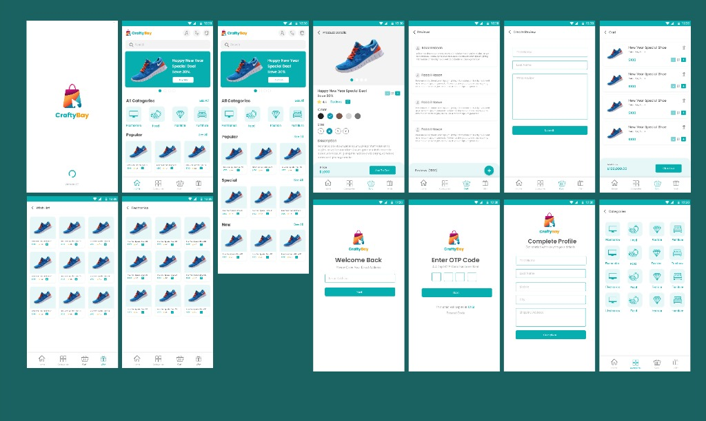
</p>

---

## 📸 Screen-by-Screen Showcase

### 1. Onboarding & Discovery
| Splash Screen | Home Screen (Top) | Home Screen (Scroll) |
| :---: | :---: | :---: |
| 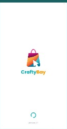 | 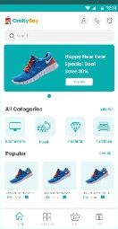 | 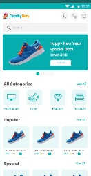 |
| Animated brand logo & version loading indicator | Promotional carousel, category pills & popular products | Special deals, new arrivals & bottom navigation |

---

### 2. Categories & Product Details
| All Categories | Category Products Grid | Product Details |
| :---: | :---: | :---: |
| 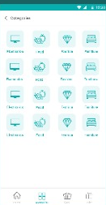 | 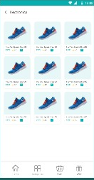 | 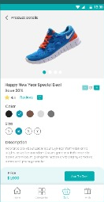 |
| 8 distinct categories with custom SVG icons | Responsive 2-column product catalog | Image carousel, color/size picker, quantity & price bar |

---

### 3. Social Proof & Saved Items
| Product Reviews | Write a Review | Wishlist |
| :---: | :---: | :---: |
| 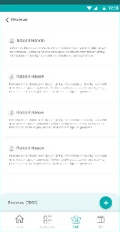 | 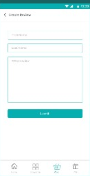 | 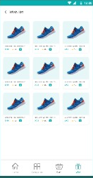 |
| Customer ratings, reviews count & feedback list | Submission form for verified customer ratings | Saved items grid with instant add-to-cart & remove |

---

### 4. Authentication & Profile
| Email Verification | OTP Code Verification | Complete Profile |
| :---: | :---: | :---: |
| 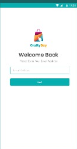 | 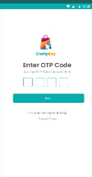 | 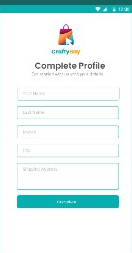 |
| "Welcome Back" screen with email input | 4-digit PIN fields with 120s timer & auto-fill | First name, last name, mobile, city & shipping address |

---

### 5. Cart, Checkout & Payment Gateway
| Shopping Cart | Checkout & Order Summary | SSLCommerz Gateway |
| :---: | :---: | :---: |
| 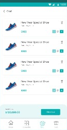 | 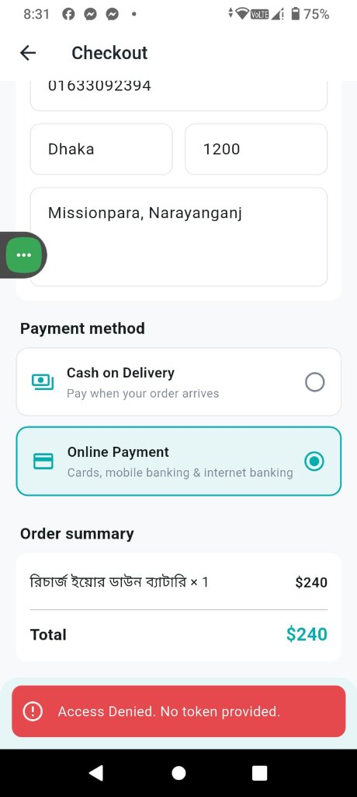 |  |
| Increment/decrement quantity, delete & live total | Address details, COD & Online Payment selection | Interactive WebView with Cards, bKash, Nagad, Rocket |

---

## 🚀 Key Features

### 🛍️ Product Catalog & Navigation
- **8 Curated Categories:** Electronics, Food, Fashion, Furniture, Books, Sports, Beauty, Appliances.
- **34 Realistic Products:** Fully enriched with titles, prices, ratings, color options, sizes, and verified high-resolution images.
- **Banner Carousel:** Auto-sliding promotions with interactive dots indicator.
- **Custom Bottom Navigation Bar:** Clean icon-based navigation between Home, Categories, Cart, and Wishlist.

### 🔐 Authentication Flow
- **Email Verification:** Fast email OTP request via `/api/UserLogin/{email}`.
- **OTP Verification:** 4-digit code entry with auto-focus, countdown timer, and fallback OTP (`1234`).
- **Complete Profile:** User profile initialization (`/api/CreateProfile`) saving user credentials for checkout.
- **Persistent Session:** JWT access tokens and user profile securely cached in `SharedPreferences`.

### 🛒 Cart & Wishlist Management
- Real-time quantity increment/decrement with immediate subtotal updates.
- One-tap Add to Cart and Add to Wishlist from both product details and catalog grids.
- Offline persistence ensuring items are never lost during network drops or app restarts.

### 💳 Checkout & Payment Gateway
- **Dual Payment Options:**
  - **Cash on Delivery (COD):** Immediate order confirmation with simulated server-side delivery processing.
  - **Online Payment (SSLCommerz):** Seamless checkout redirecting to the official SSLCommerz sandbox gateway, supporting Visa, Mastercard, AMEX, bKash, Nagad, and Rocket.
- **Order Summary:** Displays itemized list, subtotal, and grand total.
- **Error Handling & Auto-Recovery:** Automatic fallback prevents empty cart lockouts and ensures seamless checkout progression.

---

## 🏗️ Project Architecture

The project adheres to a clean, modular **GetX MVC architecture**:

```
lib/
├── app.dart                                # MaterialApp entry point, theme & route configuration
├── main.dart                               # App bootstrap & service initialization
├── core/
│   ├── constants/
│   │   ├── app_colors.dart                 # Brand color palette (Primary #07ADAE, Accents)
│   │   ├── app_strings.dart                # Static string definitions
│   │   └── api_endpoints.dart              # REST API endpoint URLs
│   ├── network/
│   │   ├── api_client.dart                 # HTTP client with timeout & error handling
│   │   └── network_caller.dart             # API request wrappers
│   ├── storage/
│   │   └── session_store.dart              # Secure SharedPreferences manager (Token, Profile, Cart)
│   ├── theme/
│   │   └── app_theme.dart                  # Material3 light theme specifications
│   └── utils/
│       └── snackbar_helper.dart            # Standardized notification banners
├── data/
│   ├── data_sources/
│   │   └── app_catalog.dart                # Enriched catalog with 34 authentic products & 8 categories
│   └── models/
│       ├── banner_model.dart               # Promotional banner schema
│       ├── cart_item_model.dart            # Shopping cart item schema
│       ├── category_model.dart             # Category schema
│       ├── product_model.dart              # Product detail & variant schema
│       ├── review_model.dart               # Product review schema
│       └── user_profile_model.dart         # Customer profile schema
└── presentation/
    ├── controllers/
    │   ├── auth_controller.dart            # Authentication & OTP state
    │   ├── banner_controller.dart          # Promotional carousel state
    │   ├── cart_controller.dart            # Reactive cart calculations & sync
    │   ├── category_controller.dart        # Category listings state
    │   ├── main_nav_controller.dart        # Bottom navigation index management
    │   ├── product_controller.dart         # Product listings & detail state
    │   ├── review_controller.dart          # Reviews retrieval & submission
    │   └── wishlist_controller.dart        # Wishlist persistence & toggle
    └── views/
        ├── auth/
        │   ├── email_verification_screen.dart
        │   ├── otp_verification_screen.dart
        │   └── complete_profile_screen.dart
        ├── cart/
        │   └── cart_screen.dart
        ├── category/
        │   ├── categories_screen.dart
        │   └── category_product_list_screen.dart
        ├── checkout/
        │   ├── checkout_screen.dart
        │   └── payment_webview_screen.dart
        ├── home/
        │   ├── home_screen.dart
        │   └── widgets/
        ├── product/
        │   ├── product_details_screen.dart
        │   ├── reviews_screen.dart
        │   └── create_review_screen.dart
        ├── splash/
        │   └── splash_screen.dart
        └── wishlist/
            └── wishlist_screen.dart
```

---

## 🛠️ Tech Stack & Dependencies

| Category | Technology | Usage |
| :--- | :--- | :--- |
| **Framework** | [Flutter 3.x](https://flutter.dev) | Cross-platform mobile SDK |
| **Language** | [Dart 3.x](https://dart.dev) | Modern strongly-typed OOP language |
| **State Management** | [GetX](https://pub.dev/packages/get) | Reactive controllers, dependency injection & routing |
| **Networking** | [http](https://pub.dev/packages/http) | RESTful API client communications |
| **Image Caching** | [cached_network_image](https://pub.dev/packages/cached_network_image) | High-performance image downloading with placeholder fallbacks |
| **Local Storage** | [shared_preferences](https://pub.dev/packages/shared_preferences) | Persistent token and local cart/wishlist storage |
| **Vector Graphics** | [flutter_svg](https://pub.dev/packages/flutter_svg) | Crisp rendering of category and navigation icons |
| **In-App Browser** | [webview_flutter](https://pub.dev/packages/webview_flutter) | Secure payment gateway rendering (SSLCommerz) |

---

## 🏁 Getting Started

### Prerequisites
- [Flutter SDK](https://docs.flutter.dev/get-started/install) (version 3.19.0 or higher recommended)
- [Dart SDK](https://dart.dev/get-dart) (version 3.3.0 or higher)
- Android Studio / VS Code with Flutter extension
- Connected Android Device or Emulator

### Installation Steps

1. **Clone the Repository:**
   ```bash
   git clone https://github.com/Rohan2002-33/crafty_bay_ecommerce_app.git
   cd crafty_bay_ecommerce_app
   ```

2. **Install Dependencies:**
   ```bash
   flutter pub get
   ```

3. **Run Code Analysis:**
   ```bash
   flutter analyze
   ```
   *(Expected: `No issues found!`)*

4. **Run Unit & Widget Tests:**
   ```bash
   flutter test
   ```
   *(Expected: `All tests passed!`)*

5. **Launch the Application:**
   ```bash
   flutter run
   ```

---

## 🧪 Testing & Verification

The project includes an automated test suite verifying critical UI widgets and business controllers:

```bash
flutter test
```

### Test Suite Coverage:
- `CartScreen` displays empty state and loads item cards accurately.
- `CartItemCard` correctly increments and decrements item counts and recalculates totals.
- `WishlistScreen` displays saved items in a responsive grid.
- `ProductDetailsScreen` properly binds color, size, and quantity selections.
- Real HTTP URL image validation across all 34 product catalog items.

---

## 💳 Payment Gateway & Checkout Flow

CraftyBay provides a complete end-to-end checkout pipeline:

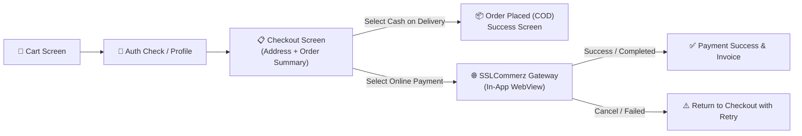

1. **Cart Review:** User reviews selected products, adjusts quantities, and initiates checkout.
2. **Authentication Gate:** Prompts unauthenticated users to verify email and OTP (default OTP: `1234`).
3. **Address & Method Selection:** Enter or auto-fill shipping details and choose COD or Online Payment.
4. **SSLCommerz Interactive WebView:** Opens the official SSLCommerz payment portal supporting mobile banking, debit/credit cards, and internet banking.

---

## 🌐 REST API Integration

The app connects to the official backend deployed at:
`https://ecom-rs8e.onrender.com/api`

| Endpoint | Method | Description |
| :--- | :---: | :--- |
| `/ListProductSlider` | `GET` | Fetches promotional carousel banners |
| `/CategoryList` | `GET` | Fetches all top-level product categories |
| `/ListProductByCategory/{id}` | `GET` | Fetches products belonging to a category |
| `/ListProductByRemark/{remark}` | `GET` | Fetches products filtered by Popular / Special / New |
| `/ProductDetailsById/{id}` | `GET` | Fetches full product details and specifications |
| `/ListReviewByProduct/{id}` | `GET` | Fetches user reviews and ratings for a product |
| `/CreateProductReview` | `POST` | Submits a customer review |
| `/UserLogin/{email}` | `GET` | Requests a 4-digit verification code to the given email |
| `/VerifyLogin/{email}/{otp}` | `GET` | Validates OTP and returns bearer authentication token |
| `/CreateProfile` | `POST` | Saves customer address and profile information |
| `/ReadProfile` | `GET` | Retrieves saved customer profile |
| `/CartList` | `GET` | Retrieves active user shopping cart items |
| `/CreateCartList` | `POST` | Adds an item to the remote user shopping cart |
| `/DeleteCartList/{id}` | `GET` | Deletes a cart item from the server |
| `/ProductWishList` | `GET` | Fetches saved wishlist items |
| `/CreateWishList/{id}` | `GET` | Adds a product to the user's wishlist |
| `/RemoveWishList/{id}` | `GET` | Removes a product from the wishlist |
| `/InvoiceCreate` | `GET` | Generates SSLCommerz payment gateway session and order invoice |

> [!NOTE]
> The backend server is hosted on a free Render tier. If the server has been idle, the first request may experience a cold-start delay of approximately 30-50 seconds. The app includes resilient local fallbacks to ensure uninterrupted operation.

---

## 👤 Author & Acknowledgements

- **Developed by:** Rohan ([@Rohan2002-33](https://github.com/Rohan2002-33))
- **Course:** Ostad Flutter Course (Module 21 & 22 Assignment)
- **License:** Distributed under the [MIT License](LICENSE).

---

<p align="center">
  Made with ❤️ using <strong>Flutter</strong> & <strong>GetX</strong>
</p>
